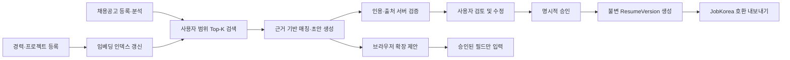
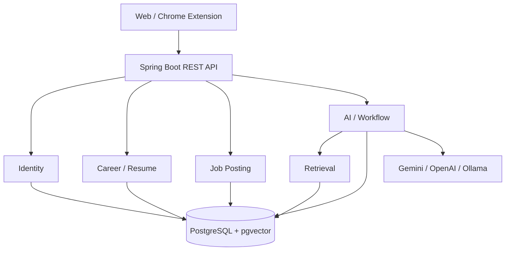

# Career Note

> 사용자 커리어 데이터를 근거로 채용 준비와 입사 지원을 돕는 AI 커리어 플랫폼

[Live Demo](https://career-note-web-sg-cjdv.onrender.com)

## 1. 프로젝트 요약

Career Note는 경력, 프로젝트, 채용공고와 이력서를 한곳에서 관리하고, 사용자가 축적한 사실만을 근거로 채용공고 분석, 직무 매칭, 이력서 및 자기소개서 초안 생성을 지원하는 서비스입니다.

일반적인 LLM 서비스가 프롬프트를 전달하고 생성 결과를 보여주는 데 집중한다면, Career Note는 다음 과정을 하나의 제품 흐름으로 연결합니다.

1. 사용자가 경력과 프로젝트를 구조화된 원본 데이터로 관리합니다.
2. 원본 데이터를 임베딩하고 사용자 범위 안에서 관련 근거를 검색합니다.
3. 검색된 근거만 LLM 컨텍스트로 전달합니다.
4. 생성 결과의 인용과 출처를 서버에서 검증합니다.
5. 사용자가 결과를 검토하고 승인해야 새 이력서 버전이 만들어집니다.
6. 승인된 이력서는 JobKorea 호환 파일이나 브라우저 확장 프로그램을 통해 실제 지원 흐름으로 이어집니다.

## 2. 어떤 유형의 서비스인가

Career Note는 단순한 AI 래퍼(wrapper)**보다 버티컬 AI 애플리케이션이 결합된 커리어 데이터 플랫폼**에 가깝습니다.

가장 적합한 정의는 다음과 같습니다.

> **근거 기반 AI 커리어 관리 및 입사 지원 플랫폼**<br>
> **A grounded AI career management and job application assistance platform**

| 분류 | Career Note의 역할 |
| --- | --- |
| 커리어 데이터 플랫폼 | 경력, 프로젝트, 채용공고, 이력서와 변경 이력을 장기적으로 관리 |
| 버티컬 AI 애플리케이션 | 채용공고 분석과 이력서 작성이라는 특정 문제에 AI 적용 |
| RAG 애플리케이션 | 사용자 소유 데이터를 검색해 근거가 있는 결과 생성 |
| 워크플로 서비스 | 공고 분석 → 근거 검색 → 초안 생성 → 검토 → 승인 → 지원 연결 |
| 브라우저 보조 도구 | 외부 지원 페이지를 읽고 사용자가 승인한 텍스트만 입력 |

### 단순 AI 래퍼와의 차이

LLM을 제거해도 Career Note에는 커리어 데이터 관리, 사용자 격리, 이력서 버전 관리, JobKorea 호환 내보내기라는 독립적인 제품 가치가 남습니다. LLM은 제품 전체가 아니라, 사용자가 축적한 데이터를 활용하는 하나의 실행 계층입니다.

서비스의 장기적인 차별점은 프롬프트 자체보다 다음 자산에서 만들어집니다.

- 사용자가 축적한 구조화된 커리어 데이터
- 원본과 파생 데이터가 분리된 데이터 모델
- 검색 및 생성 결과의 출처 추적
- 불변 이력서 버전과 명시적 승인 이력
- 평가 데이터셋과 품질 지표
- 실제 입사 지원 과정까지 연결되는 사용자 워크플로

## 3. 해결하려는 문제

기존의 범용 생성형 AI로 이력서를 작성할 때는 다음 문제가 발생할 수 있습니다.

- 사용자가 매번 자신의 경력을 프롬프트에 다시 입력해야 합니다.
- 생성된 문장이 실제 경력에서 나온 것인지 확인하기 어렵습니다.
- 수정 과정에서 이전 이력서가 사라지고 제출 이력을 추적하기 어렵습니다.
- 채용공고별로 어떤 경험을 선택해야 하는지 판단하기 어렵습니다.
- 생성 결과가 외부 채용 사이트의 실제 지원 흐름과 분리되어 있습니다.

Career Note는 커리어 데이터를 일회성 프롬프트가 아닌 **재사용 가능한 사용자 자산**으로 관리하고, AI가 참조한 근거와 사용자의 최종 승인을 함께 보존하는 방식으로 이 문제를 해결합니다.

## 4. 핵심 사용자 흐름



AI 생성 결과는 원본 데이터를 직접 덮어쓰지 않습니다. 생성 초안은 파생 데이터로 보관되고, 사용자가 검토하고 승인한 경우에만 새로운 `ResumeVersion`이 생성됩니다.

## 5. 주요 기능

### 커리어 데이터와 이력서 관리

- 사용자별 Experience, Project, JobPosting CRUD 및 소프트 삭제
- 사용자 소유권이 적용된 페이지네이션 API
- 이전 내용을 보존하는 불변 `ResumeVersion`
- 기업별 자기소개서 질문과 답변 관리
- JobKorea 필드에 맞춘 이력서 미리보기와 PDF 내보내기

### 인증과 데이터 격리

- 짧은 수명의 Stateless Access JWT
- 해시된 Refresh Session의 회전과 폐기
- 클라이언트가 전달한 `user_id`를 신뢰하지 않는 소유권 검증
- 리소스 ID와 인증 사용자 ID를 함께 사용하는 조회
- 다른 사용자 리소스 접근 시 정보 노출을 줄이기 위한 `404` 응답

### LLM 및 RAG

- Gemini 기본 제공자와 OpenAI/Ollama 대체 구성
- JSON Schema 기반 채용공고 구조화 분석
- PostgreSQL과 pgvector를 사용한 사용자 범위 벡터 검색
- Experience와 Project에 직접 연결된 임베딩 청크
- 검색 컨텍스트 크기와 Top-K 제한
- 생성 문장별 인용 라벨 및 출처 검증
- 토큰 사용량, 모델, 프롬프트 버전과 출처 스냅샷을 포함한 불변 AI 결과

### 안전한 실행과 외부 연결

- 허용 목록 기반 Tool Catalog
- 변경 작업에 필요한 일회용·단기·인자 결합 승인 토큰
- 단계 수, 비용 단위와 제한 시간이 있는 결정적 워크플로
- JobKorea 로그인·업로드·최종 제출을 자동화하지 않는 사용자 통제 경계
- 브라우저 확장에서 사용자가 승인한 텍스트 필드만 입력
- 비밀번호, 쿠키, Refresh Token과 백엔드 비밀정보를 확장 프로그램에서 수집하지 않음

### 품질과 운영

- 검색 Recall/Precision, 인용 유효성·커버리지, 미지원 주장, 지연시간과 토큰 사용량 평가
- Git으로 버전 관리되는 평가 케이스와 사람 검토 어노테이션
- PostgreSQL Testcontainers 기반 통합 테스트
- Actuator liveness/readiness와 요청 ID 기반 오류 추적
- Docker Compose 기반 전체 스택 패키징
- 백엔드 테스트, 프런트엔드 빌드, Compose 검증, 이미지 빌드와 취약점 리포트를 위한 CI 품질 게이트

## 6. 시스템 아키텍처

Spring Boot 모듈러 모놀리스를 사용하고 기능 단위 패키지 안에서 다음 의존성 방향을 유지합니다.

```text
API → Application → Domain → Infrastructure
```



초기 단계에서 마이크로서비스를 선택하지 않은 이유는 도메인 경계가 발전하는 과정에서 분산 트랜잭션과 운영 복잡성을 먼저 도입할 필요가 없었기 때문입니다. 모듈 경계와 의존성 방향을 명확히 유지해 향후 측정 결과가 필요성을 입증할 때 분리할 수 있도록 했습니다.

## 7. 기술 스택

| 영역 | 기술 |
| --- | --- |
| Backend | Java 25, Spring Boot 4.1.1, Spring MVC, Spring Security, Spring Data JPA |
| Frontend | React 19, TypeScript 6, Vite 8 |
| Database | PostgreSQL, pgvector, Flyway |
| AI | Gemini, OpenAI Responses API, Ollama, JSON Schema Structured Output |
| Retrieval | Source-linked chunking, vector embedding, cosine Top-K, HNSW index |
| Testing | JUnit, Spring Boot Test, Testcontainers PostgreSQL |
| Delivery | Docker, Docker Compose, Nginx, GitHub Actions |
| Documentation | OpenAPI/Swagger, ADR, Phase completion records, runbooks |

## 8. 핵심 설계 결정과 트레이드오프

### PostgreSQL과 pgvector를 함께 사용

별도의 벡터 데이터베이스 대신 관계형 원본 데이터와 벡터를 PostgreSQL에서 함께 관리했습니다. 초기 운영 복잡성과 데이터 동기화 실패 가능성을 줄이고 트랜잭션 및 사용자 필터를 활용할 수 있다는 장점이 있습니다. 대규모 검색 부하가 확인되면 별도 벡터 인프라를 검토할 수 있지만, 현재 단계에서는 측정되지 않은 확장성을 위해 복잡성을 선반영하지 않았습니다.

### 출처 연결을 데이터 모델에 포함

`source_type + source_id` 형태의 제약 없는 다형 참조 대신 임베딩 청크가 Experience 또는 Project 원본과 명시적으로 연결되도록 설계했습니다. 이 방식은 새로운 원본 유형을 추가할 때 스키마 변경이 필요할 수 있지만, 참조 무결성과 사용자 소유권 검증이 명확합니다.

### 인용과 사실 검증을 구분

유효한 인용은 모델이 허용된 근거를 참조했다는 의미이지, 문장 전체가 사실이라는 보장은 아닙니다. 따라서 인용 라벨 검증과 별도로 사람이 검토한 claim-support 평가 데이터를 유지하고 미지원 주장 비율을 측정합니다.

### 생성과 승인을 분리

AI 결과를 이력서에 즉시 반영하지 않고 불변 초안으로 저장합니다. 사용자의 명시적 승인 후에만 새 `ResumeVersion`을 만들기 때문에 한 단계가 추가되지만, 잘못된 생성 결과가 원본이나 제출 문서를 덮어쓰는 위험을 줄이고 감사 가능성을 확보합니다.

### JobKorea 자동화를 지원 경계에서 중단

공식 개인 이력서 쓰기 API가 없는 상황에서 로그인, CAPTCHA 우회, 쿠키 재사용이나 자동 제출을 구현하지 않았습니다. 대신 검토된 파일 생성과 사용자 주도 업로드, 승인된 필드 입력까지만 지원합니다. 편의성보다 계정 보안, 서비스 약관과 사용자 통제를 우선한 결정입니다.

## 9. 품질 검증 방식

기능 구현 여부와 AI 품질을 분리해 검증합니다.

- 도메인/API: 정상 처리, 잘못된 입력, 미존재 리소스, 인증 실패와 사용자 간 접근 차단
- 데이터베이스: Flyway 마이그레이션, 제약 조건과 PostgreSQL 실제 동작
- 이력서: 버전 불변성과 순차 버전 번호 동시성 보호
- 검색: 사용자 격리, 원본 유형 필터와 Top-K 결과
- 생성: 허용되지 않은 인용 거부와 근거가 없는 주장 측정
- 운영: 컨테이너 빌드, 헬스 체크, Compose 의존성 순서와 프런트엔드 프록시
- 보안: 승인 토큰의 단일 사용, 만료, 인자 결합과 사용자 소유권

AI 평가에서는 하나의 점수로 품질을 단순화하지 않고 검색 품질, 인용 연결, 사실 지원, 지연시간, 토큰과 비용을 각각 관찰합니다.

## 10. 프로젝트에서 보여주는 역량

- CRUD를 넘어 인증, 소유권과 불변 이력을 포함한 백엔드 도메인 설계
- RAG를 데모 수준의 프롬프트가 아닌 출처·검증·평가 가능한 시스템으로 구현
- AI 결과를 신뢰하지 않고 서버 검증과 사용자 승인을 제품 흐름에 포함
- API, 데이터베이스, 프런트엔드, 브라우저 확장과 컨테이너 운영 경계 설계
- 공식 API와 보안 경계를 고려해 구현하지 않을 기능을 명시적으로 결정
- ADR, 단계별 완료 기록과 실행 가능한 검증 결과를 통한 기술 의사결정 문서화

## 11. 현재 한계와 다음 과제

- 평가 데이터셋은 품질 계약을 검증하는 초기 규모이며 통계적으로 충분한 벤치마크는 아닙니다.
- 브라우저 확장의 JobKorea semantic adapter는 실제 페이지 변화에 대한 지속적인 측정이 필요합니다.
- 현재 배포 구조는 포트폴리오·데모 부하에 맞춰져 있으며 운영 트래픽에 대한 용량 검증은 별도 과제입니다.
- 중앙 집중형 트레이싱, 관리형 백업 보존, 자동 롤백과 대규모 동시성 대응은 측정 결과에 따라 도입해야 합니다.
- LLM의 사실 정확도는 인용만으로 보장할 수 없으므로 사용자 검토와 평가 데이터 확장이 계속 필요합니다.

## 12. 한 문장 소개

> Career Note는 사용자의 커리어 데이터를 장기 자산으로 관리하고, 검색된 근거와 명시적 승인을 바탕으로 이력서 작성부터 실제 입사 지원까지 연결하는 버티컬 AI 플랫폼입니다.

## 관련 문서

- [프로젝트 실행 및 전체 기능](README.md)
- [개발자용 기술·비즈니스 로직](README.developers.md)
- [검증된 RAG 인용 설계](docs/adr/0003-validated-rag-citations.md)
- [명시적 이력서 초안 승인](docs/adr/0005-explicit-resume-draft-approval.md)
- [브라우저 확장 프로그램 경계](docs/adr/0020-browser-extension-application-assistance.md)
- [평가 단계 완료 기록](docs/phases/phase-8.md)
- [배포 패키징 완료 기록](docs/phases/phase-11.md)
