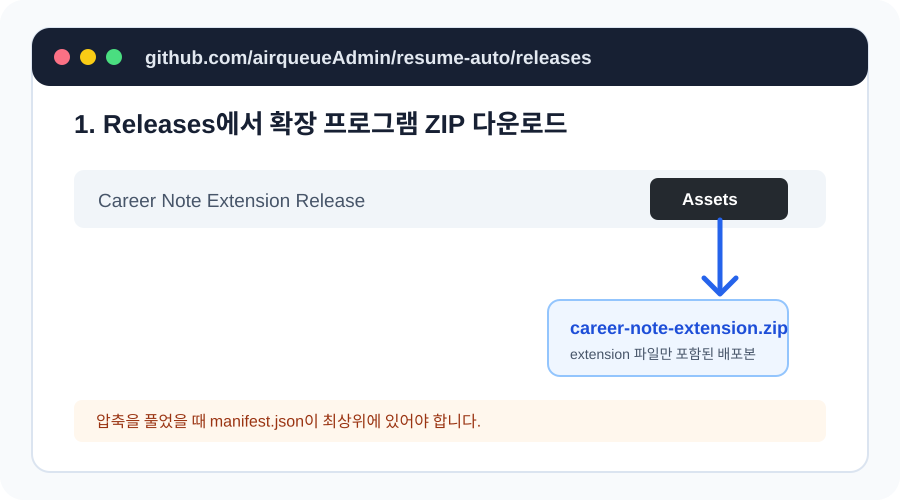
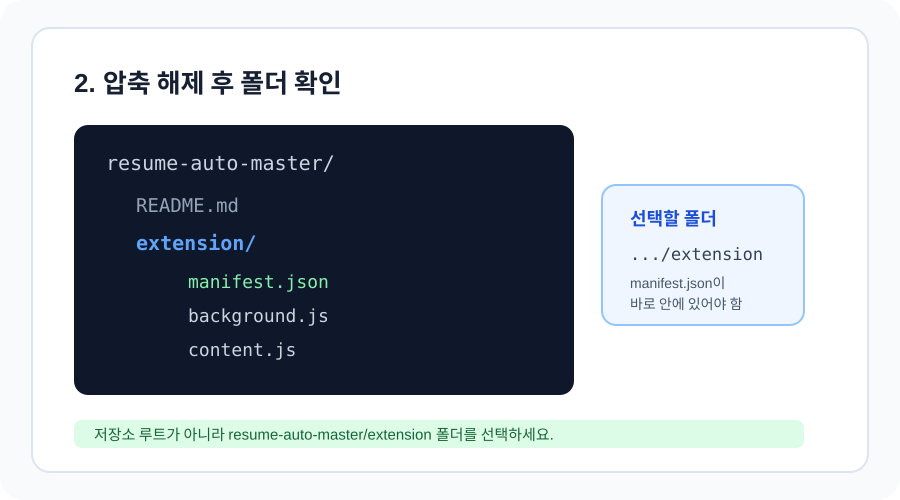
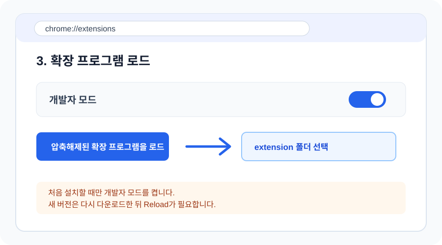
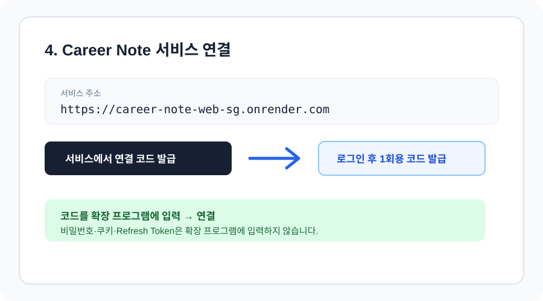

# Career Note Chrome 확장 프로그램 사용자 가이드

이 문서는 Chrome Web Store를 사용하지 않고 무료로 Career Note 확장 프로그램을 설치하는 방법을
안내합니다.

배포자는 `extension` 폴더의 파일만 담은 ZIP을 GitHub Releases에 올리고, 사용자는 그 ZIP을
다운로드한 뒤 개발자 모드의 **압축해제된 확장 프로그램 로드**로 설치합니다. 새 버전이 나오면
다시 ZIP을 다운로드하고 확장 프로그램을 Reload해야 합니다.

## 1. GitHub Releases에서 확장 프로그램 ZIP 다운로드

아래 Releases 페이지에서 최신 버전의 Assets에 있는 확장 프로그램 전용 ZIP을 다운로드합니다.

[Career Note Releases](https://github.com/airqueueAdmin/resume-auto/releases)



파일명은 다음과 같은 형태입니다.

```text
career-note-extension-v0.3.4.zip
```

이 ZIP은 저장소 전체가 아니라 `extension` 폴더의 파일만 포함해야 합니다. 배포자는 저장소
루트에서 다음 명령으로 만들 수 있습니다.

```powershell
Compress-Archive -Path extension\* -DestinationPath career-note-extension-v0.3.4.zip -Force
```

### 배포 ZIP을 아직 만들지 않은 경우

임시로 [저장소 전체 ZIP](https://github.com/airqueueAdmin/resume-auto/archive/refs/heads/master.zip)을
다운로드할 수도 있습니다. 이 경우 압축 해제 후 `resume-auto-master/extension` 폴더를 선택합니다.

## 2. ZIP 압축 해제

다운로드한 확장 프로그램 전용 ZIP을 원하는 위치에 압축 해제합니다. 다음과 같은 폴더 구조가
되어야 합니다.

```text
career-note-extension-v0.3.4/
├── manifest.json
├── background.js
├── content.js
└── popup.html
```



중요한 점은 `manifest.json`이 바로 들어 있는 배포 폴더를 Chrome에 선택하는 것입니다.

## 3. Chrome에 확장 프로그램 로드

Chrome 데스크톱 브라우저에서 다음 순서로 진행합니다.

1. 주소창에 `chrome://extensions` 입력
2. 우측 상단 **개발자 모드** 활성화
3. **압축해제된 확장 프로그램을 로드** 클릭
4. 압축 해제한 `career-note-extension-v0.3.4` 폴더 선택

저장소 전체 ZIP을 사용한 경우에는 `resume-auto-master/extension` 폴더를 선택합니다.



설치가 완료되면 확장 프로그램 목록에 `Career Note Application Assistant`가 표시됩니다.

## 4. Production 서비스 연결

확장 프로그램을 처음 열면 서비스 주소가 다음과 같이 설정되어 있어야 합니다.

```text
https://career-note-web-sg.onrender.com
```



1. JobKorea 공고 또는 지원 페이지를 엽니다.
2. 화면 우측 하단의 Career Note 버튼을 클릭합니다.
3. **서비스에서 연결 코드 발급**을 클릭합니다.
4. Career Note에 로그인하고 1회용 연결 코드를 발급합니다.
5. 확장 프로그램에 코드를 입력하고 **확장 프로그램 연결**을 클릭합니다.

서비스 주소에는 백엔드 주소인 `https://career-note.onrender.com`을 입력하지 않습니다. 확장
프로그램은 프론트엔드 주소의 `/api` 프록시를 사용합니다.

## 5. 사용 순서

1. Career Note 웹서비스에서 Experience와 Project를 등록합니다.
2. 저장하면 검색 데이터가 자동으로 업데이트됩니다. 기존 데이터가 준비되지 않은 경우에는
   **경력·프로젝트 관리**에서 해당 기록을 한 번 저장한 뒤 확장 프로그램에서
   **준비 상태 새로고침**을 클릭합니다.
3. JobKorea 공고에서 Career Note 패널을 엽니다.
4. 공고를 확인하고 필요한 검토용 이력서 또는 답변 초안을 생성합니다.
5. 생성된 내용을 직접 검토합니다.
6. 승인한 답변만 현재 입력 필드에 반영합니다.
7. 최종 제출은 반드시 JobKorea에서 직접 진행합니다.

확장 프로그램은 비밀번호, 쿠키, Refresh Token, CAPTCHA를 수집하거나 최종 지원 제출을 자동화하지
않습니다.

## 6. 업데이트 방법

현재 무료 배포 방식은 Chrome Web Store 자동 업데이트를 사용하지 않습니다.

새 버전이 안내되면 다음 순서로 업데이트합니다.

1. 최신 ZIP을 다시 다운로드합니다.
2. 압축을 해제합니다.
3. `chrome://extensions`에서 기존 Career Note 확장 프로그램을 제거합니다.
4. **압축해제된 확장 프로그램을 로드**를 다시 선택합니다.
5. 새 `extension` 폴더를 선택합니다.
6. JobKorea 페이지를 새로고침합니다.

버전 업데이트 후 서비스 연결 코드를 다시 발급해야 할 수 있습니다. Chrome Web Store에 등록하지
않는 한 GitHub push만으로 사용자 브라우저의 확장 프로그램이 자동 업데이트되지는 않습니다.

## 문제 해결

### `manifest.json`을 찾을 수 없다고 나오는 경우

저장소 루트가 아닌 다음 폴더를 선택했는지 확인합니다.

```text
resume-auto-master/extension
```

### 서비스 주소가 localhost로 보이는 경우

확장 프로그램 패널의 서비스 주소를 아래 값으로 바꾸고 저장합니다.

```text
https://career-note-web-sg.onrender.com
```

### 패널이 보이지 않는 경우

- JobKorea 페이지를 새로고침합니다.
- 확장 프로그램이 활성화되어 있는지 확인합니다.
- `chrome://extensions`에서 오류가 표시되는지 확인합니다.
- Render Free 서비스가 잠들어 있었다면 첫 요청에 시간이 걸릴 수 있으므로 잠시 기다립니다.

### 로컬 Docker 서비스에 연결하려는 경우

개발·테스트 목적이라면 서비스 주소를 다음으로 바꿀 수 있습니다.

```text
http://localhost:5173
```

운영 사용자는 항상 다음 Production 주소를 사용합니다.

```text
https://career-note-web-sg.onrender.com
```
